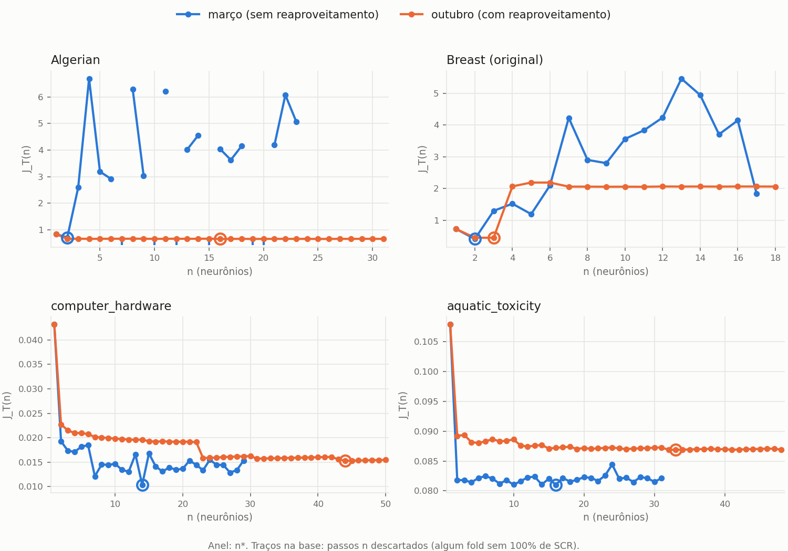
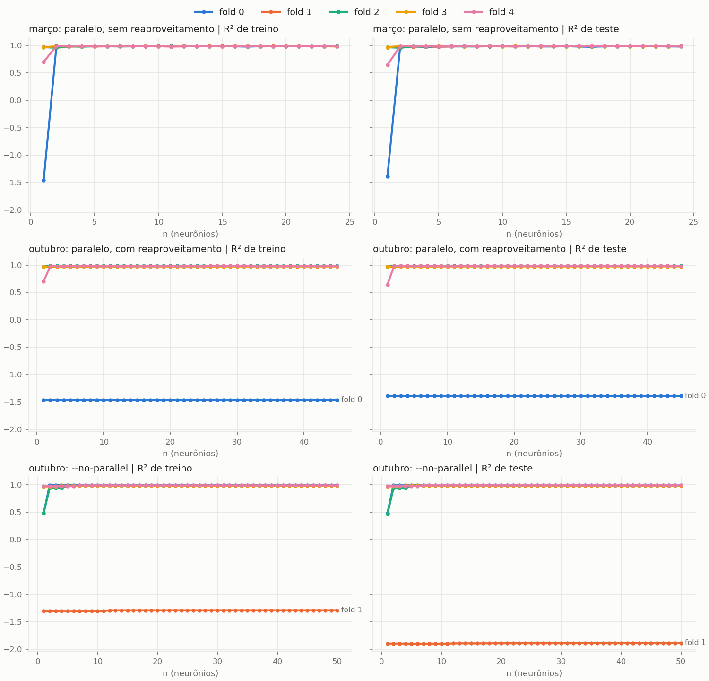
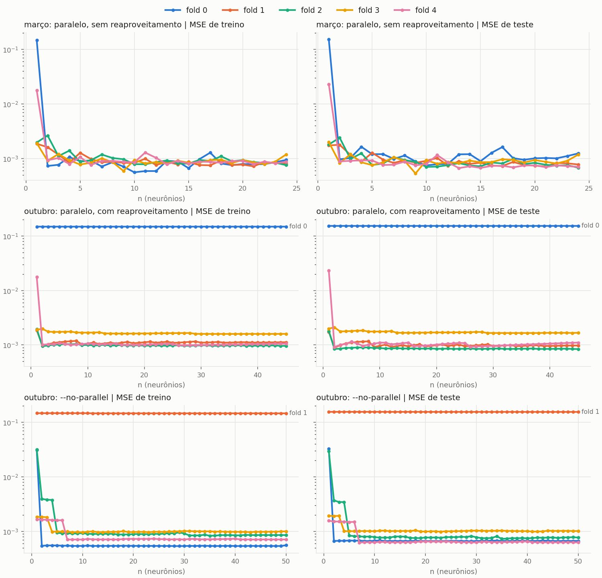

# DCV do WILCAR-C: março (sem reaproveitamento) vs. outubro (com reaproveitamento)

Em março, o worker paralelo do DCV recriava o modelo a cada n e não restaurava `_vcd_previous_param` (o atributo só era criado dentro de `constructive_step`). O WILCAR-C, portanto, reinicializou a rede inteira a cada n nos 16 DCVs. A correção (`a30890a`) restaura o reaproveitamento e faz o estado dos folds avançar só em passos aceitos (todos os K folds com 100% de SCR). Mesmas flags de março e 4 threads do BLAS por worker, como em março (ver `README.md`).

`J_T(1) idêntico`: em n = 1 não há reaproveitamento, então o valor tem de coincidir com março quando os dados são os mesmos. Isso confirma que a única mudança está nos passos n ≥ 2. `frac. decresc.`: fração dos passos aceitos consecutivos em que J_T diminui. `passos`: último n aceito.

`atingiu n_max`: o laço chegou a n = n_max (50; 5 no BCD) sem parar pela paciência (15 passos aceitos sem melhora; passos descartados não contam). Com `sim`, a busca foi truncada pelo limite, e n* pode estar subestimado.

## Regressão

| Dataset | versão | n* | J_T* | R² (CV) | SCR % | passos | descartados | atingiu n_max | frac. decresc. | tempo (min) | J_T(1) idêntico |
|---|---|---|---|---|---|---|---|---|---|---|---|
| airfoil_self_noise | mar | 6 | 0.072113 | 0.5784 ± 0.0530 | 100.0 | 21 | 0 | não | 0.40 | 10.1 |  |
| airfoil_self_noise | out | 17 | 0.072667 | 0.5744 ± 0.0364 | 100.0 | 32 | 0 | não | 0.77 | 1.6 | sim |
| computer_hardware | mar | 14 | 0.010363 | 0.8588 ± 0.0746 | 100.0 | 29 | 0 | não | 0.57 | 5.8 |  |
| computer_hardware | out | 44 | 0.015278 | 0.8137 ± 0.0876 | 100.0 | 50 | 0 | **sim** | 0.45 | 3.0 | sim |
| energy_heating | mar | 6 | 0.026824 | 0.9264 ± 0.0091 | 100.0 | 21 | 0 | não | 0.50 | 29.8 |  |
| energy_heating | out | 49 | 0.028897 | 0.9214 ± 0.0044 | 100.0 | 50 | 0 | **sim** | 0.47 | 10.5 | sim |
| energy_cooling | mar | 5 | 0.035118 | 0.8927 ± 0.0072 | 100.0 | 20 | 0 | não | 0.53 | 16.3 |  |
| energy_cooling | out | 9 | 0.039245 | 0.8804 ± 0.0171 | 100.0 | 24 | 0 | não | 0.43 | 2.3 | sim |
| lavender_friction | mar | 15 | 0.014477 | 0.9308 ± 0.0312 | 100.0 | 30 | 0 | não | 0.55 | 2.3 |  |
| lavender_friction | out | 27 | 0.028410 | 0.8673 ± 0.0211 | 100.0 | 42 | 0 | não | 0.34 | 0.7 | sim |
| optical_network | mar | 4 | 0.124003 | 0.5597 ± 0.0289 | 100.0 | 19 | 0 | não | 0.50 | 1.3 |  |
| optical_network | out | 7 | 0.138618 | 0.5044 ± 0.0899 | 100.0 | 22 | 0 | não | 0.48 | 0.2 | sim |
| aquatic_toxicity | mar | 16 | 0.081022 | 0.4291 ± 0.0605 | 100.0 | 31 | 0 | não | 0.50 | 28.6 |  |
| aquatic_toxicity | out | 33 | 0.086872 | 0.3868 ± 0.0526 | 100.0 | 48 | 0 | não | 0.36 | 7.8 | sim |
| fish_toxicity | mar | 10 | 0.053142 | 0.5433 ± 0.0388 | 100.0 | 25 | 0 | não | 0.50 | 17.0 |  |
| fish_toxicity | out | 9 | 0.054775 | 0.5287 ± 0.0448 | 100.0 | 24 | 0 | não | 0.48 | 1.3 | sim |
| real_estate | mar | 8 | 0.047422 | 0.5923 ± 0.0836 | 100.0 | 23 | 0 | não | 0.55 | 1.2 |  |
| real_estate | out | 3 | 0.046074 | 0.5949 ± 0.0688 | 100.0 | 18 | 0 | não | 0.53 | 0.1 | sim |
| synchronous_machine | mar | 9 | 0.003866 | 0.9870 ± 0.0028 | 100.0 | 24 | 0 | não | 0.48 | 3.8 |  |
| synchronous_machine | out | 30 | 0.156766 | 0.5073 ± 0.9485 | 100.0 | 45 | 0 | não | 0.45 | 2.5 | sim |
| yacht_hydrodynamics | mar | 9 | 0.004326 | 0.9864 ± 0.0079 | 100.0 | 24 | 0 | não | 0.48 | 2.3 |  |
| yacht_hydrodynamics | out | 21 | 0.004991 | 0.9846 ± 0.0088 | 100.0 | 36 | 0 | não | 0.54 | 0.3 | sim |

## Classificação

| Dataset | versão | n* | J_T* | Acc (CV) | F1 | MCC | SCR % | final_n | passos | descartados | atingiu n_max | frac. decresc. | tempo (min) | J_T(1) idêntico |
|---|---|---|---|---|---|---|---|---|---|---|---|---|---|---|
| Algerian | mar | 2 | 0.704197 | 0.959 ± 0.029 | 0.962 | 0.918 | 100.0 | 1 | 23 | 6 | não | 0.50 | 730.1 |  |
| Algerian | out | 16 | 0.650511 | 0.963 ± 0.024 | 0.967 | 0.925 | 100.0 | 1 | 31 | 0 | não | 0.47 | 5.2 | sim |
| Breast (original) | mar | 2 | 0.412711 | 0.974 ± 0.012 | 0.963 | 0.943 | 100.0 | 1 | 17 | 0 | não | 0.44 | 283.8 |  |
| Breast (original) | out | 3 | 0.450542 | 0.972 ± 0.014 | 0.962 | 0.940 | 100.0 | 1 | 18 | 0 | não | 0.65 | 10.1 | sim |
| Breast (diagnostic) | mar | 3 | 0.545349 | 0.968 ± 0.007 | 0.957 | 0.932 | 100.0 | 2 | 5 | 0 | **sim** | 0.50 | 257.0 |  |
| Breast (diagnostic) | out | 1 | 1.199640 | 0.933 ± 0.036 | 0.920 | 0.868 | 100.0 | 1 | 5 | 0 | **sim** | 0.00 | 103.8 | sim |
| Heart Failure | mar | 1 | 2.343980 | 0.799 ± 0.033 | 0.677 | 0.555 | 100.0 | 1 | 16 | 0 | não | 0.27 | 242.4 |  |
| Heart Failure | out | 1 | 2.185649 | 0.819 ± 0.024 | 0.708 | 0.596 | 100.0 | 1 | 17 | 1 | não | 0.33 | 534.6 | n/a (dados corrigidos) |
| Pima | mar | 3 | 2.471744 | 0.756 ± 0.012 | 0.620 | 0.449 | 100.0 | 3 | 18 | 0 | não | 0.35 | 213.2 |  |
| Pima | out | 2 | 2.429426 | 0.767 ± 0.022 | 0.644 | 0.476 | 100.0 | 1 | 17 | 0 | não | 0.31 | 23.7 | n/a (dados corrigidos) |

## Tempo do DCV do WILCAR-C por dataset

| Dataset | março (min) | outubro (min) | passos mar/out |
|---|---|---|---|
| airfoil_self_noise | 10.1 | 1.6 | 21/32 |
| computer_hardware | 5.8 | 3.0 | 29/50 |
| energy_heating | 29.8 | 10.5 | 21/50 |
| energy_cooling | 16.3 | 2.3 | 20/24 |
| lavender_friction | 2.3 | 0.7 | 30/42 |
| optical_network | 1.3 | 0.2 | 19/22 |
| aquatic_toxicity | 28.6 | 7.8 | 31/48 |
| fish_toxicity | 17.0 | 1.3 | 25/24 |
| real_estate | 1.2 | 0.1 | 23/18 |
| synchronous_machine | 3.8 | 2.5 | 24/45 |
| yacht_hydrodynamics | 2.3 | 0.3 | 24/36 |
| Algerian | 730.1 | 5.2 | 23/31 |
| Breast (original) | 283.8 | 10.1 | 17/18 |
| Breast (diagnostic) | 257.0 | 103.8 | 5/5 |
| Heart Failure | 242.4 | 534.6 | 16/17 |
| Pima | 213.2 | 23.7 | 18/17 |

Notas:

- Breast (diagnostic): `--max-neurons 5`, como em março (`vcd_20260328_200827`); com n_max = 5 o laço sempre chega ao limite.
- Heart Failure e Pima: a versão de outubro usa os CSVs corrigidos, então a comparação mistura a correção dos dados e o reaproveitamento.
- Tempos: as runs de outubro rodaram com `nice -n 10` e dividiram a máquina com outras re-rodadas; não são comparáveis com março.

## Curvas J_T(n)

Dados em `jt_curves.csv`.

## synchronous_machine: um fold preso numa solução ruim de n = 1

**Versão final (4 threads por worker, `vcd_20261027_073947_reg`):** R² = 0,5073 ± 0,9485, n\* = 30, 45 passos,
nenhum descartado, não chega a n_max. **O fold 0 continua preso** (R² de teste −1,390, de treino −1,463); os outros
quatro folds ficam entre 0,974 e 0,985. A versão com 3 threads (`vcd_20261026_122026`, substituída) dá o mesmo
resultado até a 9ª casa decimal.

Em março, sem reaproveitamento, o DCV deu 0,987 ± 0,003 (n\* = 9); no K-fold do cap. 5, 0,990 ± 0,004. O
diagnóstico, sem nenhuma mudança de código, mostra que **não é erro da correção, e sim comportamento do método com
reaproveitamento**.

**Onde e como degenera.** O fold 0 degenera **já em n = 1**: R² de treino −1,463 e de teste −1,390 (MSE 0,148 e
0,152). A solução foi aceita na 1ª tentativa, porque atingiu SCR = 100%. O SLSQP reportou `success=True`, status 0,
"Optimization terminated successfully", com nit = 9 e fun = 0,148. Ou seja, convergiu formalmente para um ponto
estacionário ruim. Nos 44 passos seguintes o fold 0 parte desse estado, o SLSQP converge de novo com sucesso, e o
R² de treino fica entre −1,4631 e −1,4629.

**Não é erro da correção:**

- **Estados.** Instrumentado o caminho paralelo de produção (réplica bit a bit da run final), cada fold recebe
  sempre o próprio último estado aceito: 0 violações, e nenhum estado veio de outro fold.
- **Descarte.** Nenhum passo foi descartado, então a regra de descarte não foi exercida.
- **Partição e normalização.** São as de março: J_T(1) é idêntico a março (0,18095377423488446), e os dados
  normalizados do fold 0 são idênticos entre K-fold e DCV.
- **`--no-parallel`.** Com instâncias persistentes e uma sequência aleatória contínua, o fold 0 escapa em n = 2,
  mas o **fold 1** fica preso da mesma forma (R² de teste −1,89 em todos os passos). Resultado: n\* = 41,
  R² = 0,412 ± 1,151, e o laço chega a n_max = 50. O fenômeno aparece no fold que tiver o sorteio desfavorável.

**Por que março e o K-fold não mostram o problema.** Em março, sem reaproveitamento, cada n reinicializava a rede:
a solução ruim de n = 1 era um ponto isolado e o fold se recuperava em n = 2. O K-fold usa outra semente para o
fold 0 do M2 (`seed + 100·fold + método` = 2; no DCV, `seed + 100·fold` = 0). Partição, normalização e pesos da
linearização são os mesmos. Um teste fatorial em n = 1 (pesos da linearização das sementes 0 ou 2 × sequência
aleatória das sementes 0 ou 2) mostra que o desfecho depende só da sequência aleatória, isto é, do valor inicial de
W2 do único neurônio:

- semente 0 (DCV): W2 = −0,213, R² de treino = −1,463;
- semente 2 (K-fold): W2 = +0,088, R² de treino = 0,990 (nit = 82).

Com a semente 2, o fold 0 do K-fold fica em R² ≈ 0,990 de n = 1 a n = 22, com n\* = 7 e R² de teste = 0,98796,
como em março.

**Implicação.** O critério de aceitação (100% de SCR) não exige qualidade de ajuste. Com reaproveitamento de pesos,
uma solução ruim aceita em n = 1 é herdada por todos os passos seguintes daquele fold. Nada foi alterado: nem
critério, nem configuração, nem a re-semeadura.

Curvas por fold (R² e MSE de treino e de teste por n; março, outubro paralelo e outubro `--no-parallel`):
`sync_folds_r2.png`, `sync_folds_mse.png`. Valores em `sync_folds.csv`. As curvas vêm de execuções instrumentadas
com 4 threads do BLAS, como os workers de março. A de outubro (paralelo) reproduz bit a bit a run final, e a de março
reproduz bit a bit `vcd_20260310_140932` (todos os J_T(n), n\* = 9, 24 passos). Com 3 threads, a réplica de março
desviava até 6 × 10⁻⁷ em termos relativos para n ≥ 2. Isso mostra que a run de regressão de 10/03 também tinha
4 threads por worker. No painel de março, o fold 0 também é ruim em n = 1, mas se recupera em n = 2, porque a rede
é reinicializada.

